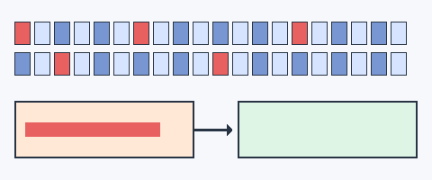

## 一句话
Redis 组合使用惰性删除与定期删除清理过期 key，残留的再由内存淘汰策略兜底。

## 要点
- [kp1|2] 惰性删除：访问 key 时检查是否过期，过期则删除
- [kp2|2] 定期删除：serverCron 按 hz 频率抽查过期字典并删除过期 key
- [kp3] 每轮默认抽查 20 个，过期比例超过 10% 就继续，且有时间上限
- [kp5] 两者都可能有残留，内存不足时由 maxmemory-policy 兜底

## 详解
### 惰性删除
读写命令访问 key 前都会调用 `expireIfNeeded`：已过期就删除并当作不存在处理。只靠它的话，从不被访问的过期 key 会一直占用内存。

### 定期删除
`activeExpireCycle` 在 `serverCron` 中按 `hz`（默认 10，即每秒 10 次）执行：

1. 从过期字典（只含设置了过期时间的 key）中按游标逐批取出 key，默认每批 20 个；
2. 删除其中已过期的 key；
3. 若这一批的过期比例超过 10%，说明过期 key 仍多，继续下一批；
4. 单次执行有时间上限（慢周期最多约占 25% CPU 时间），避免阻塞主线程。

Redis 5 及以前的阈值是 25%、且为随机抽样；Redis 6 改为游标扫描，并新增 `active-expire-effort`（1–10，默认 1）调高力度，代价是更多 CPU。



### 主从复制
从节点不主动删除过期 key，而是等主节点同步 `DEL`；但从节点读取时会把逻辑过期的 key 当作不存在返回。

## 示例
```bash
redis-cli CONFIG GET hz
redis-cli CONFIG GET active-expire-effort
redis-cli INFO stats | grep expired_keys
```

## 易错点
- 把过期删除与内存淘汰（LRU / LFU）混为一谈
- 以为 key 到期的瞬间一定被删除
- 以为定期删除每次会遍历全部带过期时间的 key

## 追问
### [f1] 大量 key 同时过期会怎样？如何避免？
定期删除每批的过期比例持续偏高，会连续抽查直到触达时间上限，造成 CPU 抖动和延迟升高；业务上还可能引发缓存雪崩。给过期时间加随机偏移，把到期时间打散。

### [f2] 为什么不在 key 到期时用定时器立即删除？
为每个 key 维护定时器内存与 CPU 开销都很大，而 Redis 主线程是单线程，大量定时器回调会阻塞正常请求。惰性 + 定期抽查是在内存与 CPU 之间的折中。
